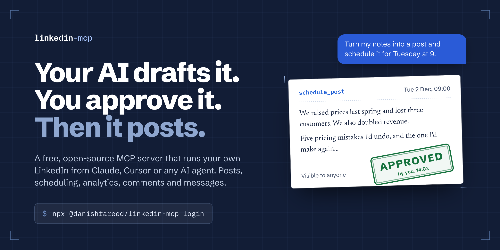
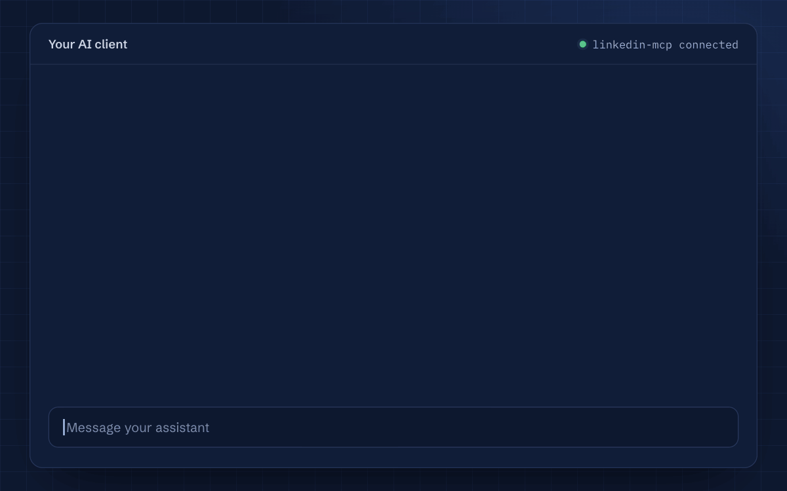
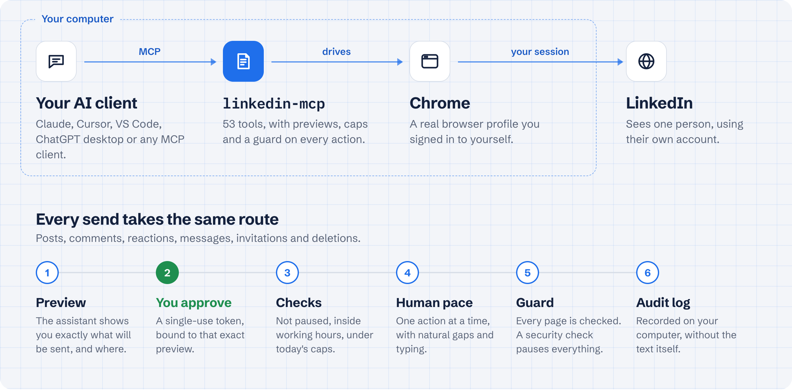
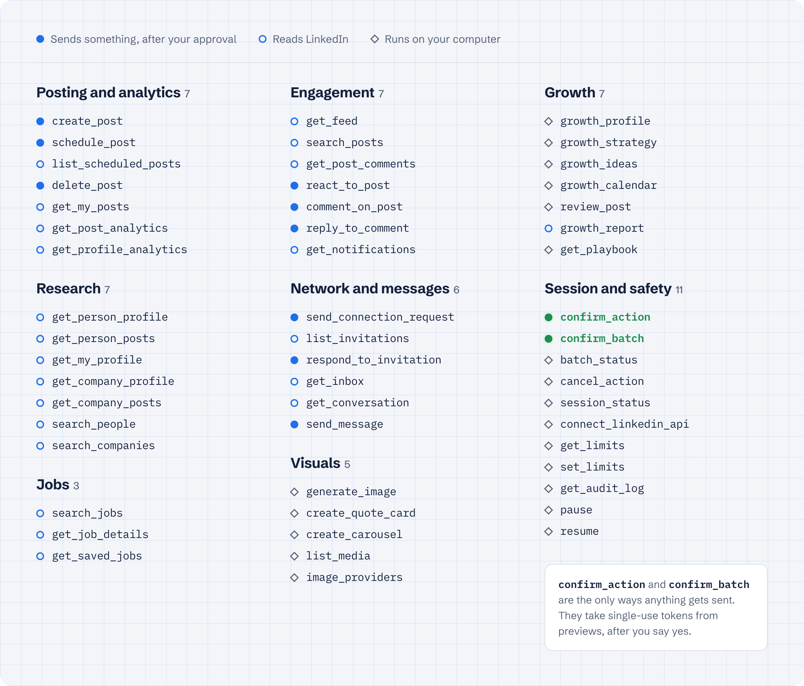
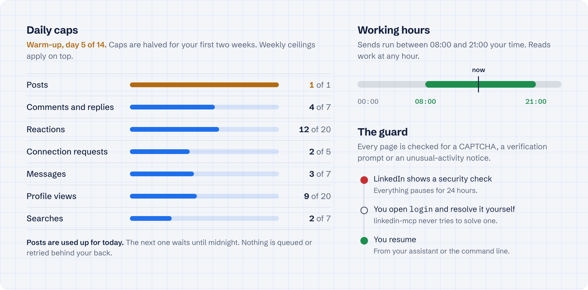

<p align="center">
  
</p>

<h1 align="center">LinkedIn MCP Server</h1>

<p align="center"><b>Free, open-source LinkedIn automation for Claude, Cursor and any AI agent.</b><br>
Build a strategy, plan your week, write and design posts, schedule them, and learn from your analytics, all from your AI assistant, with your approval before anything is sent.</p>

<p align="center">
  <a href="https://www.npmjs.com/package/@danishfareed/linkedin-mcp"></a>
  <a href="https://github.com/danishfareed/Linkedin-MCP/actions/workflows/ci.yml"></a>
  
  <a href="LICENSE"></a>
</p>

<p align="center">
  <a href="#quick-start">Quick start</a> &nbsp;·&nbsp;
  <a href="#what-you-can-ask">What you can ask</a> &nbsp;·&nbsp;
  <a href="#grow-not-just-post">Growth</a> &nbsp;·&nbsp;
  <a href="#tools">Tools</a> &nbsp;·&nbsp;
  <a href="#safety">Safety</a> &nbsp;·&nbsp;
  <a href="docs/clients.md">Client setup</a> &nbsp;·&nbsp;
  <a href="#faq">FAQ</a>
</p>

**LinkedIn MCP** is a [Model Context Protocol](https://modelcontextprotocol.io) server that lets your AI assistant run **your own** LinkedIn account. Ask Claude, Cursor, VS Code or any MCP client to draft and publish posts, **schedule LinkedIn posts** with LinkedIn's own scheduler, read your **LinkedIn analytics**, answer comments, keep up with notifications and messages, search jobs, and look up people and companies. It's also a complete growth system: it keeps your brand book and strategy, plans a content calendar, checks your drafts against proven methods, makes images and carousels, and learns from your real analytics. It's built for creators, founders and job seekers, and it runs on your computer through a real Chrome browser that you sign in to yourself. No API keys, no paid service, no password stored.

<p align="center">
  
</p>

## Why it's different

- **It's a growth system, not just a poster.** It interviews you, keeps a strategy and content calendar, scores drafts with an explainable checker, draws on a sourced playbook of methods and psychology, and reports which pillars, formats and posting times actually work for you.
- **It makes the visuals.** Branded quote cards and PDF carousels rendered on your computer for free, and AI images through Higgsfield, OpenAI, Gemini, fal, Replicate or Ideogram with your own key.
- **It does the things creators actually do.** Publish and schedule posts (text, images, PDF carousels), read post and profile analytics, reply to comments, react, manage invitations and messages. Most LinkedIn MCP servers only read.
- **You approve every send.** Each post, comment, reaction, message or invitation comes back as a preview first. In clients that support it, you approve in a dialog the AI can't click for you.
- **It tells you what really happened.** After sending, it checks LinkedIn and reports `sent`, `unconfirmed` (don't retry) or `not_sent` (safe to retry), instead of assuming the click worked.
- **It keeps you at a human pace.** Daily and weekly caps, a 14-day warm-up, working hours, one action at a time, and an automatic pause the moment LinkedIn shows a security check or starts rate-limiting.
- **It installs in one line and stays installed.** `npx`, no Python. Dependencies are pinned and shrinkwrapped, so an upstream release can't break your setup overnight.

## Quick start

**1. Sign in once.** A Chrome window opens on LinkedIn. Sign in as usual, including 2FA, and the window closes by itself.

```bash
npx @danishfareed/linkedin-mcp login
```

**2. Add it to your AI client.** Most clients use this JSON:

```json
{
  "mcpServers": {
    "linkedin": {
      "command": "npx",
      "args": ["-y", "@danishfareed/linkedin-mcp"]
    }
  }
}
```

| Client | Where it goes |
|---|---|
| **Claude Desktop** | Settings → Developer → Edit Config (`claude_desktop_config.json`) |
| **Claude Code** | `claude mcp add linkedin --scope user -- npx -y @danishfareed/linkedin-mcp` |
| **Cursor** | `~/.cursor/mcp.json`, or `.cursor/mcp.json` in a project |
| **VS Code (Copilot)** | `~/.copilot/mcp-config.json`, or `.mcp.json` in a workspace |
| **Devin Desktop (formerly Windsurf)** | `~/.config/devin/mcp_config.json` |
| **Cline** | MCP Servers → Configure → `cline_mcp_settings.json` |
| **ChatGPT desktop** | Settings → MCP servers → Add server → STDIO (or `~/.codex/config.toml`) |

Paths for every OS, local HTTP mode and timeout settings are in **[docs/clients.md](docs/clients.md)**.

**3. Check it.** Restart your client and ask *"Check my LinkedIn session status."* To check every page linkedin-mcp reads:

```bash
npx @danishfareed/linkedin-mcp doctor
```

**4. Optional: post through LinkedIn's official API.** If you have (or create) a LinkedIn developer app, posts can publish through LinkedIn's own API instead of the browser. See [Official API posting](#official-api-posting-optional).

> [!TIP]
> **Try it with nothing sent.** Add `"env": { "LINKEDIN_MCP_DRY_RUN": "true" }` to the config above: every action is previewed and simulated. Or use `LINKEDIN_MCP_READ_ONLY=true` to hide every tool that sends something.

> [!NOTE]
> **Early release (0.1).** The safety layer is tested end to end. The parts that read and click LinkedIn's pages are new, and LinkedIn changes its layout often, so some tools will need fixes as more people use them. Run `doctor` to check yours and [report anything broken](https://github.com/danishfareed/Linkedin-MCP/issues/new?template=broken-selector.yml).

## Official API posting (optional)

By default linkedin-mcp does everything through the browser. If you connect your own LinkedIn developer app, `create_post` publishes through LinkedIn's official [Posts API](https://learn.microsoft.com/en-us/linkedin/marketing/community-management/shares/posts-api) instead: no page layout to break, a definite result from LinkedIn, and the action you take most often goes through the route LinkedIn provides for it. Everything else (scheduling with LinkedIn's own scheduler, analytics, comments, messages) stays on the browser.

```bash
npx @danishfareed/linkedin-mcp connect-api
```

The command walks you through it:

1. Create an app at [linkedin.com/developers/apps/new](https://www.linkedin.com/developers/apps/new) and link it to a LinkedIn Page you admin (a Page admin verifies the link).
2. Under **Products**, add **Share on LinkedIn** and **Sign In with LinkedIn using OpenID Connect**. Both are self-serve.
3. Under **Auth**, add the redirect URL `http://localhost:8765/callback`, then paste the Client ID and Client Secret when asked.
4. Click **Allow** on LinkedIn's page. The connection is saved in your data folder, readable only by you.

Already have a developer app from another tool? Reuse it; just make sure the redirect URL above is listed. Your assistant can also start the connection with the `connect_linkedin_api` tool once the app's ID and secret are in the config.

| `LINKEDIN_MCP_POST_VIA` | What happens |
|---|---|
| `auto` (default) | API when connected, browser otherwise. The preview says which. |
| `api` | Always the API. If it isn't connected, posting stops with a clear error instead of falling back. |
| `browser` | Never the API. |

Good to know:

- LinkedIn's connections last 60 days and can't be refreshed by ordinary apps. `session_status` and `status` show the days left; run `connect-api` again to renew. When it lapses in `auto` mode, posts go back through the browser.
- Text and images (one or several) go through the API. PDF carousels and scheduled posts use the browser.
- Previews, your approval, caps, working hours and the audit log apply exactly the same way.
- `disconnect-api` deletes the saved connection.

## How it works

<picture>
  <source media="(prefers-color-scheme: dark)" srcset="docs/assets/how-it-works-dark.png">
  
</picture>

Everything runs on your computer. linkedin-mcp drives a real Chrome window with your own saved session, one action at a time. Nothing leaves your machine except the browser's normal traffic to LinkedIn: no telemetry, no hosted component.

## Grow, not just post

<details open>
<summary><b>The weekly loop</b></summary>

```
 You (once)          Your assistant, every week                          You
 ──────────          ──────────────────────────                          ───
 brand book  ─►  strategy ─► ideas ─► calendar ─► drafts ─► visuals ─►  approve the week
                    ▲                                                        │
                    └──────────── growth_report (what worked) ◄── LinkedIn ◄─┘
```

</details>

1. **"Interview me and build my LinkedIn strategy."** Your assistant asks about you, your audience, offer, goals and proof in small batches, saves it all in a local brand book, and drafts a strategy: positioning, content pillars, funnel mix, cadence and KPIs. You approve it.
2. **"Plan my week."** It turns the strategy and idea bank into a calendar, drafts each post with a method and hook from the playbook, runs every draft through `review_post`, and makes a carousel or image where it helps.
3. **Approve the week in one sitting.** Every post has its own preview. In clients with dialogs you tick each one, and LinkedIn's own scheduler publishes them, even with your computer off.
4. **"Review my month."** `growth_report` reads your analytics, keeps a history, and tells you what's working, with honest confidence levels on small samples. The strategy adapts.

Clients that show MCP prompts list these as `start_growth_strategy`, `plan_my_week`, `write_post`, `engagement_session`, `profile_audit`, `monthly_growth_review`, `repurpose_post` and `reply_to_comments`. The playbook behind them is about 24,000 words of sourced material: how LinkedIn distributes posts (every claim labelled by evidence), persuasion psychology, 48 hooks, 28 post formats, strategy, profile, engagement, writing and measurement.

Full guide, including image provider setup and brand settings: **[docs/growth.md](docs/growth.md)**.

## What you can ask

**Posting and scheduling**
- "Turn these meeting notes into a LinkedIn post and schedule it for Tuesday at 9am."
- "Post this carousel PDF with the title 'Five pricing mistakes' and a short intro."
- "What do I have scheduled this week?"

**Analytics**
- "How did my last five posts do? Which one got the most impressions per reaction?"
- "Who saw my post about hiring? Show me the demographics."
- "How many profile viewers and search appearances did I get this week?"

**Engagement**
- "Summarise the comments on my latest post and draft a reply to each question."
- "What's new in my notifications? Anything I should respond to?"
- "Find posts from this week about MCP servers, newest first, and suggest three I could add something useful to."

**Strategy and visuals**
- "Interview me and build my LinkedIn strategy. My goal is 20 qualified leads a quarter."
- "Score this draft and fix whatever fails."
- "Turn my last post into a 6-slide carousel in my brand colors."
- "Generate a header image for Thursday's post with Higgsfield."

**Jobs, research and network**
- "Find remote senior product designer roles posted this week and summarise the three best fits."
- "Look up the founders of Northwind Labs and tell me what they've posted about recently."
- "Who's sent me connection requests? Accept the ones who work in product."
- "Read my conversation with Chris and draft a reply suggesting Thursday."

## Tools

<picture>
  <source media="(prefers-color-scheme: dark)" srcset="docs/assets/tools-dark.png">
  
</picture>

All tools return compact JSON. Tools that send something return a preview and a `confirmation_token`. Nothing happens until `confirm_action` is called with it, after you approve.

<details>
<summary><b>Posting and analytics</b></summary>

| Tool | What it does | Type |
|---|---|---|
| `create_post` | Publish a post now: text up to 3,000 characters, up to 9 images, or a PDF/PPTX/DOCX carousel with a title. Visibility: anyone or connections. | Sends · post cap |
| `schedule_post` | Same inputs plus `publish_at`. Uses LinkedIn's own scheduler, so it publishes even when your computer is off. 15-minute slots, 30 minutes to 90 days ahead. | Sends · post cap |
| `list_scheduled_posts` | Posts waiting in LinkedIn's scheduler. | Reads |
| `delete_post` | Delete one of your posts. | Sends |
| `get_my_posts` | Your recent posts (up to 20) with impressions, reactions, comments and reposts. | Reads |
| `get_post_analytics` | Impressions, members reached, profile views, followers gained, reactions, comments, reposts, saves, sends and top viewer demographics for one of your posts. | Reads |
| `get_profile_analytics` | Post impressions, followers, profile viewers and search appearances, with LinkedIn's trend for each. | Reads |

</details>

<details>
<summary><b>Engagement</b></summary>

| Tool | What it does | Type |
|---|---|---|
| `get_feed` | Recent posts from your home feed (up to 20), each with its own link. Promoted posts skipped. | Reads |
| `search_posts` | Search posts by keywords, by relevance or newest first, optionally from the past 24 hours, week or month, or only posts with photos, videos or documents (up to 20). | Reads · search cap |
| `get_post_comments` | Comments and replies on a post (up to 50), each with an id for replying. | Reads |
| `react_to_post` | Like, celebrate, support, love, insightful or funny. Never removes an existing reaction. | Sends · reaction cap |
| `comment_on_post` | Comment on a post (up to 1,250 characters). | Sends · comment cap |
| `reply_to_comment` | Reply to a specific comment. | Sends · comment cap |
| `get_notifications` | Recent notifications with links (up to 30). | Reads |

</details>

<details>
<summary><b>Jobs</b></summary>

| Tool | What it does | Type |
|---|---|---|
| `search_jobs` | Up to 25 jobs by keywords and location, filtered by date posted, on-site/remote/hybrid, experience level and Easy Apply. | Reads · search cap |
| `get_job_details` | One job's title, company, location, workplace type, salary and applicant count when shown, description, and how to apply. | Reads |
| `get_saved_jobs` | Jobs you've saved on LinkedIn. | Reads |

linkedin-mcp never applies to jobs for you.

</details>

<details>
<summary><b>Research (read-only, capped)</b></summary>

| Tool | What it does | Type |
|---|---|---|
| `get_person_profile` | One person's profile: name, headline, location, plus the sections you ask for (about, experience, education, skills, certifications, languages, volunteering, projects). | Reads · profile-view cap |
| `get_person_posts` | A person's recent posts (up to 20) with dates, reactions, comments and links. | Reads · profile-view cap |
| `get_my_profile` | Your own profile. | Reads |
| `get_company_profile` | A company's overview, website, industry, size, headquarters, founding year, specialties and followers. | Reads · profile-view cap |
| `get_company_posts` | A company page's recent posts (up to 20). | Reads · profile-view cap |
| `search_people` | Up to 10 people: name, headline, location, profile URL, degree. Filters: network, title, company, first/last name, school. No bulk export. | Reads · search cap |
| `search_companies` | Up to 10 companies. | Reads · search cap |

</details>

<details>
<summary><b>Network and messages</b></summary>

| Tool | What it does | Type |
|---|---|---|
| `send_connection_request` | Connect with an optional note (200 characters, 300 with Premium). | Sends · connection cap |
| `list_invitations` | Pending invitations, received or sent. | Reads |
| `respond_to_invitation` | Accept or ignore a received invitation. | Sends |
| `get_inbox` | Recent conversations with last message, time and unread status (up to 20). | Reads |
| `get_conversation` | Messages in one conversation (up to 50), by thread URL or a connection's profile. Opening a thread marks it read on LinkedIn. | Reads |
| `send_message` | Message a connection or an existing thread. Checks the recipient's name before typing. | Sends · message cap |

</details>

<details>
<summary><b>Growth</b></summary>

| Tool | What it does | Type |
|---|---|---|
| `growth_profile` | Your brand book: role, offer, audience, goals, proof bank, voice, banned phrases, brand visuals. Says what's missing. | Local |
| `growth_strategy` | Draft, approve (only when you say so) or archive your strategy: pillars, funnel mix, cadence, formats, KPIs. Versioned, with a readable `strategy.md`. | Local |
| `growth_ideas` | The idea bank: thesis, pillar, funnel stage, method, hooks, evidence, source. | Local |
| `growth_calendar` | Dated slots from your cadence with drafts and media. Ready slots carry the input for `schedule_post`. Never schedules by itself. | Local |
| `review_post` | Explainable draft score: hook and fold, readability, length, specificity, AI tells, hashtags, links, engagement bait, CTA, your banned phrases, repeated openings. | Local |
| `growth_report` | Reads your posts and analytics, keeps a history, ranks pillars, formats and posting times, tracks KPIs. | Reads |
| `get_playbook` | Sourced methods, hooks, psychology and strategy, by topic or search. | Local |

</details>

<details>
<summary><b>Visuals</b></summary>

| Tool | What it does | Type |
|---|---|---|
| `create_quote_card` | Branded quote image, rendered on your computer. | Local |
| `create_carousel` | Branded PDF carousel (3–15 slides) with PNG previews, ready for `create_post`. | Local |
| `generate_image` | AI image through Higgsfield, OpenAI, Gemini, fal, Replicate or Ideogram, with your own key (may cost money). | Calls your provider |
| `list_media` | Recent generated files. | Local |
| `image_providers` | Which providers are set up, and how to set up the others. | Local |

</details>

<details>
<summary><b>Session and safety</b></summary>

| Tool | What it does |
|---|---|
| `session_status` | Whose account, paused or not, warm-up, read-only and dry-run modes. Answers from saved state without opening the browser unless you pass `verify: true`. |
| `get_limits` | Usage today and over the last 7 days against every cap, with reset times. |
| `set_limits` | Change daily caps: lower freely, or raise up to the hard ceiling. |
| `get_audit_log` | Recent write actions, guard trips and pauses. |
| `pause` / `resume` | Stop all LinkedIn activity (optionally for N minutes) and start it again. |
| `confirm_action` | Run a previewed action with its token, after you approve. |
| `confirm_batch` | Approve up to 10 previewed scheduled posts, comments, replies or reactions together (for example a planned week). In clients with dialogs you tick each one. |
| `batch_status` | Results of a batch, item by item. |
| `cancel_action` | Throw away a preview's token. |
| `connect_linkedin_api` | Optional: connect your own LinkedIn developer app so posts publish through the official API. Opens LinkedIn's consent page. |

</details>

## Safety

LinkedIn's terms don't allow automation (see the [disclaimer](#disclaimer)), and accounts that behave like bots get restricted. linkedin-mcp is designed so that the defaults keep your activity looking like what it is: one person, using their own account, at a human pace.

<picture>
  <source media="(prefers-color-scheme: dark)" srcset="docs/assets/safety-dark.png">
  
</picture>

### You approve everything that's sent

- Every tool that sends something returns a preview of exactly what will be sent and where, plus a single-use `confirmation_token` that expires after 10 minutes.
- The token is bound to the exact text, target and files in the preview. Attached files are fingerprinted, and a file that changes before you confirm is refused.
- **Approval in your AI client.** When your client supports MCP dialogs (elicitation), `confirm_action` also asks you directly, showing every field of the preview. The model can't answer that dialog, so a feed post or message written to manipulate your assistant can't get anything sent. Declining sends nothing.
- Feed posts, comments and messages are passed to your assistant as data from other people. Read previews before approving, especially messages and connection notes.

### Sends are checked, not assumed

After the final click, linkedin-mcp reads LinkedIn back: the message appears in the thread, the invitation shows as pending, the comment is under the post. The result is one of:

| Result | Meaning | Retry? |
|---|---|---|
| `sent` | Confirmed on LinkedIn. | No need. |
| `unconfirmed` | The send button was clicked but LinkedIn didn't show the result. | **No.** Check LinkedIn first, or you may send it twice. |
| `not_sent` | Stopped before sending, with the reason (for example LinkedIn asked for the person's email). | Yes, once the reason is dealt with. |

Before sending a message, linkedin-mcp checks that the conversation window names the person you asked for.

### Daily and weekly caps

| Action | Default per day | Hard ceiling per day | Ceiling per 7 days |
|---|---|---|---|
| Posts (published or scheduled) | 2 | 3 | 15 |
| Comments and replies | 15 | 30 | 150 |
| Reactions | 40 | 100 | 500 |
| Connection requests | 10 | 20 | 80 |
| Messages | 15 | 30 | 150 |
| Profile views (research) | 40 | 80 | 400 |
| Searches | 15 | 30 | 150 |
| Page loads overall | 300 | 500 | - |

- Lower any cap with `set_limits`. You can raise caps up to the hard ceiling, never above it.
- **Warm-up:** for the first 14 days after your first sign-in, every daily cap is halved.
- When a cap is hit, the tool says when it resets. Nothing is queued or retried behind your back. Attempts count even if LinkedIn then fails, so errors can't be used to go over a cap.

### Working hours and pacing

- Sends only run between 08:00 and 21:00 your local time by default. Reads work at any time.
- One browser, one tab, one action at a time, with a randomised human-like gap between actions (around 4 seconds typical), a pause after each page load and natural typing for short text.
- Each tool call has a time budget (55 seconds by default) so it answers before typical client timeouts.
- The browser uses your system's locale and timezone. Nothing is randomised or spoofed.

### Automatic pause

After every page load, linkedin-mcp checks for CAPTCHAs, verification prompts, "unusual activity" notices, restriction pages and sign-in walls, and watches for LinkedIn's rate-limit responses. If it sees one, it stops all tools (24 hours for a security check, a few hours for rate limiting), records it in the audit log, and tells you what to do. It never tries to solve a challenge.

### Audit log

Every confirmed action is appended to `~/.config/linkedin-mcp/state/audit.jsonl` with the time, tool, target, a hash of the text and the result. The text itself isn't stored. Ask your assistant for `get_audit_log`.

### What it won't do

Deliberately out of scope: multiple accounts, proxies, CAPTCHA solving, fingerprint spoofing, bulk scraping or exporting people's data, applying to jobs, and mass messaging or connection campaigns. linkedin-mcp is for running your own account, not for growth hacking.

## How it compares

The best-known open-source alternative is [stickerdaniel/linkedin-mcp-server](https://github.com/stickerdaniel/linkedin-mcp-server), a good Python server built mainly for research, jobs and outreach. linkedin-mcp is built for running your own presence. This compares the two projects' tool lists and docs as of November 2026.

| | **linkedin-mcp** (this project) | stickerdaniel/linkedin-mcp-server |
|---|---|---|
| Install | `npx` (Node 20+), pinned and shrinkwrapped | `uvx` (Python), `.mcpb` bundle, Docker or plugins |
| Create and schedule posts (images, PDF carousels) | Yes | No |
| Post through LinkedIn's official API with your own app | Yes (optional) | No |
| Post and profile analytics | Yes | No |
| Comment, reply and react | Yes | No |
| Notifications and invitation management | Yes | No |
| Strategy, idea bank, content calendar, analytics feedback loop | Yes | No |
| Draft checker and sourced growth playbook | Yes | No |
| Branded carousels and quote cards, AI images | Yes | No |
| Approve a planned week in one sitting | Yes | No |
| Feed, post search, profiles, companies, people search | Yes | Yes |
| A person's and a company's posts | Yes | Yes |
| Job search, job details, saved jobs | Yes | Yes, plus apply links and Easy Apply forms |
| Messages and connection requests | Yes | Yes, plus conversation search and archive |
| Company employees, "people also viewed" | No | Yes |
| Confirmation before sending | Preview, token, and a dialog in supporting clients | Dialog in supporting clients |
| Daily and weekly caps, warm-up, working hours | Yes | No (pacing is left to the client) |
| Read-only mode, dry-run mode | Yes | No |
| Pause on security checks and rate limits | Yes | Rate limits reported |

Paid tools do more in some areas (team features, hosted scheduling, CRM integrations) and cost a monthly subscription:

| Tool | What it's for | Price |
|---|---|---|
| [Taplio](https://taplio.com) | LinkedIn content, scheduling and analytics | From about $39/month |
| [Phantombuster](https://phantombuster.com) | Automation and data extraction across platforms | From about $69/month, limited free tier |
| [Expandi](https://expandi.io) | LinkedIn outreach campaigns | From about $99/month per account |

Prices are from each vendor's site in November 2026 and may have changed. linkedin-mcp is free and runs on your own computer.

## Configuration

Settings come from environment variables (set them under `env` in your client's MCP config) or `~/.config/linkedin-mcp/config.json`. Environment variables win.

<details>
<summary><b>All settings</b></summary>

| Environment variable | Default | What it does |
|---|---|---|
| `LINKEDIN_MCP_DRY_RUN` | `false` | Simulate sends instead of sending. |
| `LINKEDIN_MCP_READ_ONLY` | `false` | Hide every tool that can send something. |
| `LINKEDIN_MCP_CONFIRM_IN_CLIENT` | `true` | Ask for approval in a dialog when the client supports it. |
| `LINKEDIN_MCP_CONFIRM_REACTIONS` | `true` | `false` lets reactions run without a confirmation step. |
| `LINKEDIN_MCP_HEADLESS` | `true` | `false` shows the browser window while the assistant works. |
| `LINKEDIN_MCP_WORKING_HOURS` | `08:00-21:00` | When sends may run, local time. `off` disables the check. Overnight ranges like `22:00-06:00` work. |
| `LINKEDIN_MCP_TOOL_TIMEOUT_SECONDS` | `55` | Time budget for one tool call (20 to 600). Raise it if your client allows longer calls. |
| `LINKEDIN_MCP_IDLE_TIMEOUT_MINUTES` | `10` | Close the browser after this long without a tool call. |
| `LINKEDIN_MCP_BROWSER_CHANNEL` | `auto` | `auto` (Chrome if installed, else bundled Chromium), `chrome`, `chromium` or `msedge`. |
| `LINKEDIN_MCP_CHROME_PATH` | | Path to a specific Chrome executable. |
| `LINKEDIN_MCP_HOME` | `~/.config/linkedin-mcp` | Where the profile, settings and state live. On Windows the default is `%LOCALAPPDATA%\linkedin-mcp`. |
| `LINKEDIN_MCP_POST_VIA` | `auto` | `auto`, `api` or `browser`: how `create_post` publishes. See [Official API posting](#official-api-posting-optional). |
| `LINKEDIN_MCP_CLIENT_ID` / `LINKEDIN_MCP_CLIENT_SECRET` | | Your LinkedIn developer app, for API posting. `connect-api` can save them to `config.json` for you. |
| `LINKEDIN_MCP_API_REDIRECT_PORT` | `8765` | Port for the API connection's redirect URL (`http://localhost:<port>/callback`). |
| `LINKEDIN_MCP_API_VERSION` | two months back | `LinkedIn-Version` header (YYYYMM), if LinkedIn rejects the default. |
| `LINKEDIN_MCP_PORT` | `3333` | Port for `--http` mode. |
| `LINKEDIN_MCP_HTTP_TOKEN` | generated | Bearer token for `--http` mode. |

Image providers (`OPENAI_API_KEY`, `HF_API_KEY_ID` and `HF_API_KEY_SECRET` for Higgsfield, and others) and brand settings (`LINKEDIN_MCP_BRAND_THEME`, colors, font, logo) are listed in [docs/growth.md](docs/growth.md#visuals).

Example `~/.config/linkedin-mcp/config.json`:

```json
{
  "workingHours": { "start": "09:00", "end": "18:30" },
  "confirm": { "reactions": true, "inClient": true },
  "limits": { "comment": 10, "connection": 5 },
  "toolTimeoutSeconds": 90
}
```

</details>

## Command line

```bash
npx @danishfareed/linkedin-mcp                  # start the MCP server over stdio (what clients run)
npx @danishfareed/linkedin-mcp login            # sign in, in a visible browser window
npx @danishfareed/linkedin-mcp status           # sign-in, pause, warm-up and limits summary
npx @danishfareed/linkedin-mcp doctor           # check the browser, sign-in and every page it reads (read-only)
npx @danishfareed/linkedin-mcp resume           # clear a pause after you've resolved a LinkedIn check
npx @danishfareed/linkedin-mcp install-browser  # download the Chromium build this version expects
npx @danishfareed/linkedin-mcp connect-api      # optional: post through LinkedIn's official API with your own app
npx @danishfareed/linkedin-mcp disconnect-api   # remove the API connection
npx @danishfareed/linkedin-mcp logout           # delete the saved browser profile
npx @danishfareed/linkedin-mcp --http           # local Streamable HTTP on 127.0.0.1:3333/mcp, token required
```

Other options: `--headed` (show the browser while serving), `--dry-run`, `--port <n>`, `status --verify`, `doctor --offline`, `login --keep-open`, `logout --yes`.

## FAQ

<details>
<summary><b>Will my account get banned?</b></summary>

It can happen. LinkedIn's User Agreement prohibits automated access, and LinkedIn does restrict accounts it thinks are automated. linkedin-mcp is built to keep the risk down: a real browser you signed in to yourself, one thing at a time at a human pace, conservative daily and weekly caps, halved caps for the first two weeks, working hours, and a full stop the moment LinkedIn shows a warning or starts rate-limiting. It doesn't hide what it is or try to beat detection. There's no guarantee. Don't use it on an account you can't afford to lose.

</details>

<details>
<summary><b>Can it run my LinkedIn on autopilot?</b></summary>

Almost. Your assistant does the strategy, ideas, calendar, drafts, checks and visuals, and LinkedIn's scheduler publishes. The one thing it won't do is send without you: you approve each post, usually a whole week in one sitting with `confirm_batch`. Accounts that post without their owner are what LinkedIn restricts, and keeping you in the loop also means a post or message written to manipulate your assistant can't get anything sent.

</details>

<details>
<summary><b>Is it really free?</b></summary>

Yes. It's open source under Apache-2.0, runs entirely on your computer, and has no paid tier, account or telemetry. You need an AI client that supports MCP (many have free plans) and a LinkedIn account.

</details>

<details>
<summary><b>Can my assistant send something without me?</b></summary>

Not through linkedin-mcp. Every send needs a token from a preview, and `confirm_action` is the only way to use it. In clients that support MCP dialogs, you also approve in a dialog the model can't answer. For extra certainty, set `LINKEDIN_MCP_READ_ONLY=true` and the sending tools disappear entirely.

</details>

<details>
<summary><b>Does it store my password?</b></summary>

No. You sign in yourself in a normal Chrome window. linkedin-mcp keeps only the browser profile, which holds the session cookies, in `~/.config/linkedin-mcp/profile/` on your computer. Delete it any time with `logout`. Sign in with your email and password or a passkey: Google and Apple sign-in usually refuse to work inside an automated browser.

</details>

<details>
<summary><b>Do scheduled posts need my computer on?</b></summary>

No. `schedule_post` uses LinkedIn's built-in scheduler, so LinkedIn publishes the post at the scheduled time.

</details>

<details>
<summary><b>Does it work with Sales Navigator or Recruiter?</b></summary>

No. It works with regular LinkedIn (free or Premium). Sales Navigator, Recruiter, company page admin, ads, job applications, polls, events and video uploads aren't supported.

</details>

<details>
<summary><b>Can I run it on a server or in the cloud?</b></summary>

It's designed for your own computer, where you sign in and where LinkedIn already sees you. Running it from a data centre IP is far more likely to trigger LinkedIn's security checks. There's no hosted version.

</details>

<details>
<summary><b>Does it work if my LinkedIn is in another language?</b></summary>

Reading mostly works. Sending needs LinkedIn's display language set to English: linkedin-mcp checks the page language before it types anything and stops with `UNSUPPORTED_LANGUAGE` rather than failing halfway. Change it under Settings → Account preferences → Display language. Contributions for other languages are welcome.

</details>

<details>
<summary><b>Which AI clients does it work with?</b></summary>

Any client that supports local MCP servers over stdio: Claude Desktop, Claude Code, Cursor, VS Code, Devin Desktop (formerly Windsurf), Cline, the ChatGPT desktop app and others. ChatGPT on the web can't reach a server on your computer. See [docs/clients.md](docs/clients.md).

</details>

<details>
<summary><b>Can I use it alongside stickerdaniel's LinkedIn MCP server?</b></summary>

Yes. linkedin-mcp keeps its data in `~/.config/linkedin-mcp`, separate from that server's `~/.linkedin-mcp`, so they don't share a browser profile or delete each other's files. Both are separate browser sessions on the same account, though, so LinkedIn sees the combined activity. Don't run them both heavily.

</details>

## Troubleshooting

Run `npx @danishfareed/linkedin-mcp doctor` first. Common fixes:

- **`NOT_LOGGED_IN`**: run `npx @danishfareed/linkedin-mcp login`.
- **`CHECKPOINT` or `CIRCUIT_OPEN`**: LinkedIn showed a security check and everything is paused. Run `login`, resolve it in the window, then ask your assistant to `resume`.
- **`RATE_LIMITED`**: LinkedIn is limiting requests. linkedin-mcp has paused itself; wait, and lower your caps if it happens again.
- **`SELECTOR_BROKEN`**: LinkedIn changed its layout. [Report it](https://github.com/danishfareed/Linkedin-MCP/issues/new?template=broken-selector.yml) with the selector name from the error.
- **"No usable browser was found"**: install Chrome, or run `npx @danishfareed/linkedin-mcp install-browser`.

Full guide by error code: **[docs/troubleshooting.md](docs/troubleshooting.md)**.

## Contributing

The most valuable help is keeping up with LinkedIn's layout changes. Every selector lives in one file, [`src/linkedin/selectors.ts`](src/linkedin/selectors.ts), and parsers are tested against saved page snapshots, so most fixes are a few lines plus a test. See **[CONTRIBUTING.md](CONTRIBUTING.md)**. The images in this README are HTML in [`docs/assets/src`](docs/assets/src), rendered with `node scripts/assets/render.mjs`.

## Disclaimer

linkedin-mcp is an independent open-source project. It is not affiliated with, endorsed by or sponsored by LinkedIn Corporation or Microsoft. LinkedIn is a trademark of LinkedIn Corporation.

LinkedIn's [User Agreement](https://www.linkedin.com/legal/user-agreement) prohibits using software to access the service in automated ways, and LinkedIn may restrict or close accounts that do. By using linkedin-mcp you accept that risk. Use it only with your own account, and follow LinkedIn's [Professional Community Policies](https://www.linkedin.com/legal/professional-community-policies). The software is provided as is, without warranty of any kind (see the licence).

## Licence

[Apache-2.0](LICENSE)
